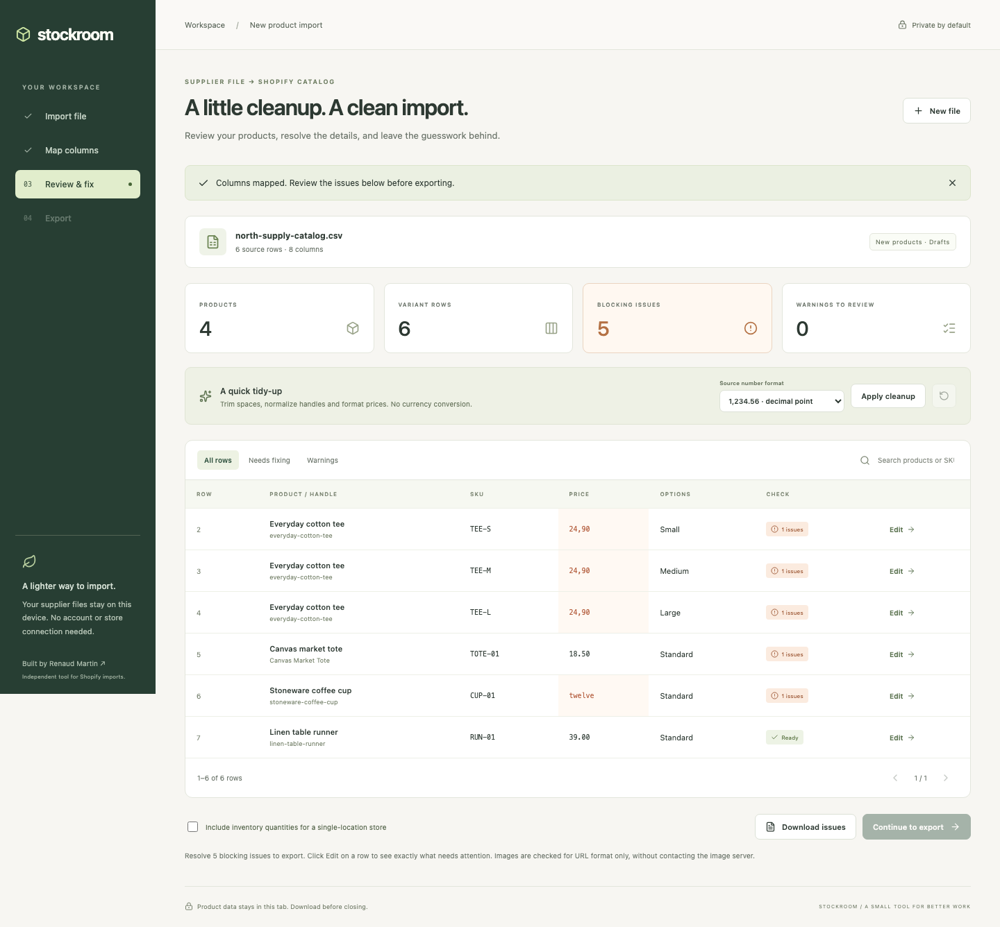

# Stockroom

Turn supplier spreadsheets into Shopify product imports. Map columns, review issues, edit values, and export a checked CSV — entirely in your browser.

[Open Stockroom](https://rjamartin.github.io/product-import-fixer/) · [Portfolio case study](docs/CASE_STUDY.md)



## What it does

- Imports UTF-8 CSV and TSV files, including quoted values and multiline descriptions.
- Suggests column mappings from supplier headers, supports fallback values, and saves a reusable mapping locally.
- Groups product variants by handle, with up to three option dimensions.
- Flags conflicting product details, duplicate variant combinations, invalid prices, missing option pairs, and malformed image URLs.
- Provides editable rows, search, issue filters, a downloadable issue report, and undo for the last bulk change.
- Normalizes whitespace, handles and prices using an explicit decimal convention. It never converts currencies.
- Exports new products as **drafts**, hidden from the online store. Single-location inventory is optional and disabled by default.

## Try the sample

1. Choose **Try sample file**, then **Apply mapping & review**.
2. Set **Source number format** to **decimal comma** and choose **Apply cleanup**.
3. Edit source row 6 and replace `twelve` with `12.00`.
4. Optionally enable single-location inventory. Continue to export and download the Shopify CSV.

The sample deliberately contains price and handle problems so the repair flow is visible.

## Run locally

Requires Node.js 22.12 or newer.

```sh
npm ci
npm run dev
```

```sh
npm test
npm run build
npm run preview
npm run format:check
```

No backend, API keys, store credentials or database are required.

## GitHub Pages

In **Settings → Pages**, use **GitHub Actions** as the publishing source. Run **Actions → Deploy to GitHub Pages → Run workflow** on `main` to publish a new version. Deployment is manual; normal pushes run the separate CI checks without changing the live app.

Vite uses relative asset paths, so the build works under `/product-import-fixer/` as well as a custom-domain root.

## Scope and export contract

Stockroom prepares **new product imports**, not updates to an existing store. Leave Shopify's overwrite option unchecked. It has no access to existing handles, inventory locations, store settings, currency, media availability or Shopify's import result.

The exporter uses the current Shopify header names for its supported fields, comma separators, UTF-8, and LF newlines. Rows are grouped by handle; shared product data appears on the first row. It includes default option information for simple products and the related inventory fields when inventory is enabled. Optional fields unused by every row are omitted.

Rules were checked against [Shopify's CSV documentation](https://help.shopify.com/en/manual/products/import-export/using-csv), [import troubleshooting](https://help.shopify.com/en/manual/products/import-export/common-import-issues), and [official sample CSV](https://help.shopify.com/csv/product_template.csv) on **2026-10-03**. Shopify's documented fields evolve; the supported export schema lives in `src/catalog.ts`.

**A passing local check does not guarantee Shopify accepts a file.** Review Shopify's import preview and test a small batch before importing a large catalog. The project has not been tested against a connected live Shopify store.

### Limits

- UTF-8 text files only: 5 MB, 10,000 data records, and 100 source columns. XLSX is not supported.
- One source row represents one variant. Extra image-only rows are not supported.
- Handles are generated from titles when not mapped. Repeated titles then belong to the same product; change handles when these should be separate products.
- Price is required by this tool even though Shopify can default it to zero. Intentional free products can use `0`.
- Inventory supports non-negative whole quantities for a single-location store only.
- Image URLs are checked syntactically; the app does not fetch them. Ensure images are publicly reachable before importing.
- No taxonomies, metafields, market-specific prices, shipping weights, barcodes, custom fulfillment services, or store synchronization in this release.
- Formula-like values generate warnings. Shopify exports preserve text rather than adding apostrophes to product identifiers; review these warnings before opening an export in spreadsheet software. The separate issue report escapes formula-like values.

## Privacy

Product rows remain in memory and disappear when the tab closes. Only a saved mapping — column names, assignments, and explicitly entered fallback values — is stored in localStorage. No catalog values are saved automatically. Export files before leaving.

All application dependencies are bundled. There are no analytics, uploads, or third-party runtime requests. Hosting receives normal page/asset requests; external documentation links only open when clicked.

## Architecture

- `src/catalog.ts`: typed mapping model, parser, transformations, validation and Shopify serialization.
- `src/App.tsx`: four-step workspace, review editor, mapping persistence and downloads.
- `src/catalog.test.ts`: focused tests for data integrity and import/export boundaries.
- `src/styles.css`: responsive workspace, desktop sidebar and mobile navigation.

TypeScript is used for browser processing and field-level type safety. React manages the interactive review state. Papa Parse handles CSV quoting and serialization. Vite generates a static build.

## Verification

15 automated tests cover identifiers, multiline CSV, malformed input, aliases, continuation rows, both number conventions, immutable cleanup, duplicate variants, product conflicts, option dependencies, inventory, image URL syntax, formula warnings, and the actual export structure.

Browser checks exercise the complete sample workflow, edit a value, enable inventory, download and parse the real CSV, remove/restore a row, and check mobile widths. No browser exceptions or third-party requests occurred in the checked workflow. Screenshots show the implemented app.

Built by [Renaud Martin](https://github.com/RJAMartin). Stockroom is an independent portfolio project, not a Shopify product or endorsed integration.
